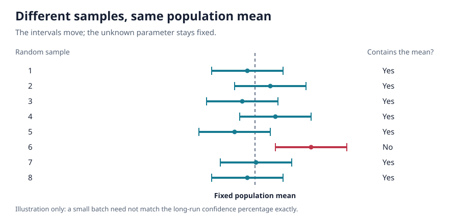

# Chapter 7 — Statistical Intervals Based on a Single Sample

**Course:** EGN 2440 — Probability & Statistics with Calculus (USF Fall 2026)
**Sections:** 7.1 Basic Properties of Confidence Intervals (pp. 268–275), 7.2 Large-Sample Confidence Intervals for a Population Mean and Proportion (pp. 276–283), 7.3 Intervals Based on a Normal Population Distribution (pp. 285–292), 7.4 Confidence Intervals for the Variance and Standard Deviation of a Normal Population (pp. 294–296).

## 1. Basic Properties of Confidence Intervals (§7.1)

> **Definition (Confidence interval).** A confidence interval (CI) gives a range of plausible values for an unknown population parameter. Its **confidence level** describes the long-run reliability of the method; its **width** describes how precisely the parameter has been estimated.

A point estimate gives one number. An interval adds information about uncertainty caused by sampling variability. For example, an interval for average component lifetime estimates the population **mean**, not the lifetimes of individual components.

### Interpreting confidence correctly

For a procedure with confidence level $100(1-\alpha)\%$,

$$
P\bigl(L(X_1,\ldots,X_n)\le\theta\le U(X_1,\ldots,X_n)\bigr)=1-\alpha.
$$

Before sampling, the endpoints are random and the parameter $\theta$ is fixed. After observing the data, the interval is fixed: it either contains the true parameter or does not.

- **Correct:** over repeated random samples, about 95% of the intervals produced by a 95% procedure contain the true parameter.
- **Incorrect:** the fixed parameter has a 95% probability of lying inside this particular already-computed interval.
- A 95% CI for a mean does **not** contain 95% of the population observations.
- A finite batch of 100 intervals need not contain exactly 95 successful intervals; 95% is a long-run rate.

### Normal mean with known population standard deviation

Assume an independent random sample from a normal population, with population standard deviation $\sigma$ **known**. Then

$$
Z=\frac{\bar X-\mu}{\sigma/\sqrt n}\sim N(0,1).
$$

> **Definition (Upper-tail critical value).** $z_\alpha$ is the standard normal cutoff with probability $\alpha$ to its right. For a two-sided CI, split the total excluded probability equally between the tails.

$$
P(-z_{\alpha/2}\le Z\le z_{\alpha/2})=1-\alpha.
$$

Rearranging to isolate $\mu$ and substituting the observed sample mean gives

$$
\boxed{\bar x\pm z_{\alpha/2}\frac{\sigma}{\sqrt n}}.
$$

The minus sign gives the lower limit; the plus sign gives the upper limit. Here the standard error of the sample mean is $\sigma/\sqrt n$.

| Two-sided confidence level | Total tail probability $\alpha$ | Probability in each tail | $z_{\alpha/2}$, rounded |
|---|---|---|---|
| 90% | 0.10 | 0.05 | 1.645 |
| 95% | 0.05 | 0.025 | 1.960 |
| 99% | 0.01 | 0.005 | 2.576 |

### Confidence, precision, and sample size

The margin of error $B$ is the **half-width**; the full width is $w=2B$:

$$
B=z_{\alpha/2}\frac{\sigma}{\sqrt n},\qquad
w=2z_{\alpha/2}\frac{\sigma}{\sqrt n}.
$$

Holding the other quantities fixed:

| Change | Effect on interval width |
|---|---|
| Higher confidence | Wider interval: the critical value increases |
| Larger population standard deviation | Wider interval |
| Larger sample size | Narrower interval; width varies inversely with $\sqrt n$ |
| Halve the desired width | Requires four times the sample size |

For a specified maximum width $w$, or equivalently margin of error $B$, choose

$$
n=\left\lceil\left(\frac{2z_{\alpha/2}\sigma}{w}\right)^2\right\rceil
=\left\lceil\left(\frac{z_{\alpha/2}\sigma}{B}\right)^2\right\rceil.
$$

**Always round the sample size up.** A narrow interval is not automatically reliable, and a high-confidence interval is not automatically precise.

### Deriving an interval from a pivot

> **Definition (Pivotal quantity).** A function of the sample and unknown parameter whose probability distribution contains no unknown parameters.

1. Find a pivot $H(X_1,\ldots,X_n;\theta)$.
2. Find known cutoffs $a,b$ enclosing probability $1-\alpha$.
3. Solve the inequalities for $\theta$.
4. Replace the random sample quantities by their observed values.

$$
P(a\le H\le b)=1-\alpha
\quad\Longrightarrow\quad
P(L\le\theta\le U)=1-\alpha.
$$

Intervals need not be symmetric around a point estimate. For an exponential population with rate $\lambda$, a useful pivot is

$$
2\lambda\sum_{i=1}^{n}X_i\sim\chi^2_{2n}.
$$

If $a,b$ are its lower and upper central cutoffs, the corresponding rate and mean-lifetime intervals are

$$
\lambda:\quad\left(\frac{a}{2\sum_{i=1}^{n}x_i},\frac{b}{2\sum_{i=1}^{n}x_i}\right),
\qquad
\mu=\frac1\lambda:\quad\left(\frac{2\sum_{i=1}^{n}x_i}{b},\frac{2\sum_{i=1}^{n}x_i}{a}\right).
$$

Taking reciprocals of positive endpoints **reverses their order**.

### Bootstrap confidence intervals

When error-distribution percentiles cannot be obtained analytically, estimate them by repeatedly sampling **with replacement** from the observed sample and recomputing the estimator.

Let $q_L,q_U$ be the lower and upper central percentiles of the estimation error. Inverting the error inequalities gives

$$
P(q_L\le\hat\theta-\theta\le q_U)\approx1-\alpha
\quad\Longrightarrow\quad
\bigl(\hat\theta-q_U,\hat\theta-q_L\bigr).
$$

For 95% confidence, these are the 2.5th and 97.5th percentiles. The book estimates them from bootstrap estimates centered at their bootstrap average:

$$
d_j^{*}=\hat\theta_j^{*}-\bar\theta^{*}.
$$

Use the upper error percentile for the **lower** endpoint and the lower error percentile for the **upper** endpoint. This error-based construction is not simply the interval between the raw bootstrap estimates' percentiles.

## 2. Large-Sample Intervals for a Mean and Proportion (§7.2)

### Population mean without assuming a normal population

For a sufficiently large independent random sample, the Central Limit Theorem makes the sample mean approximately normal. Replacing the unknown $\sigma$ with the sample standard deviation $s$ gives

$$
\boxed{\bar x\pm z_{\alpha/2}\frac{s}{\sqrt n}}.
$$

The confidence level is **approximate**. The textbook's practical guideline is $n>40$; it is not a universal guarantee for every population. The estimated standard error is $s/\sqrt n$, not $s$. If $\sigma$ is known, retain $\sigma$ instead of $s$.

To plan sample size with unknown $\sigma$, use a pilot sample, historical data, or a reasonable conservative estimate in the earlier formula. For a population that is not very skewed, dividing an estimated population range by 4 gives only a rough planning estimate of $\sigma$. The realized width is not guaranteed because the eventual $s$ is random.

### General large-sample construction

If $\hat\theta$ is approximately normal, approximately unbiased, and has a usable standard-error estimate, then

$$
\hat\theta\pm z_{\alpha/2}\widehat{\text{SE}}(\hat\theta)
$$

is an approximate CI. If the standard error depends on the parameter itself, solving the inequalities without first substituting its estimate can produce a better interval.

### Population proportion: score interval

Let $X$ count successes in $n$ trials, with sample proportion $\hat p=x/n$ and $\hat q=1-\hat p$. Use a binomial model when trials are independent; sampling without replacement from a finite population is only approximately binomial when the sample is small relative to that population.

$$
E(\hat p)=p,\qquad \text{SE}(\hat p)=\sqrt{\frac{p(1-p)}{n}}.
$$

Write $z=z_{\alpha/2}$. The **score interval** uses the adjusted center

$$
\tilde p=\frac{\hat p+z^2/(2n)}{1+z^2/n}
$$

and is

$$
\boxed{\tilde p\pm\frac{z\sqrt{\hat p\hat q/n+z^2/(4n^2)}}{1+z^2/n}}.
$$

The score center moves toward 0.5 compared with $\hat p$. The interval has more reliable coverage than the traditional approximation, especially near 0 or 1; the textbook recommends the score interval rather than routinely switching to the traditional one. Its confidence level is still approximate, not exact.

The traditional large-sample interval is

$$
\hat p\pm z_{\alpha/2}\sqrt{\frac{\hat p\hat q}{n}}.
$$

The book's practical checks for this traditional approximation are at least 10 observed successes and 10 observed failures. Even then its actual coverage can differ noticeably from the stated confidence level. At $\hat p=0$ or $\hat p=1$, its zero estimated standard error produces an uninformative zero-width interval.

### Planning a proportion sample size

The product $\hat p(1-\hat p)$ is largest at 0.5. For target **full width** $0<w<1$, the worst-case score width simplifies to

$$
w_{\max}=\frac{z}{\sqrt{n+z^2}},\qquad
n=\left\lceil z^2\left(\frac1{w^2}-1\right)\right\rceil.
$$

This conservatively controls width regardless of the observed proportion. For planning with a chosen proportion $p_0$, put $a=p_0(1-p_0)$; the positive solution of the score-width equation is

$$
n=\left\lceil\frac{z^2}{w^2}\left(2a-w^2+\sqrt{4a(a-w^2)+w^2}\right)\right\rceil.
$$

Using $p_0=0.5$ gives the worst-case formula. A choice closer to 0 or 1 relies on prior information and does not guarantee the target width for every possible sample result.

The traditional planning approximation, with margin of error $B=w/2$, is

$$
n\approx\frac{4z^2p_0(1-p_0)}{w^2}
=\frac{z^2p_0(1-p_0)}{B^2}.
$$

Round up. If no defensible planning proportion is available, use $p_0=0.5$.

### One-sided confidence bounds

> **Definition (Confidence bound).** A lower bound rules out values that are too small; an upper bound rules out values that are too large. There is no finite bound on the other side.

For a large-sample mean, the lower and upper bounds are

$$
L=\bar x-z_\alpha\frac{s}{\sqrt n},\qquad
U=\bar x+z_\alpha\frac{s}{\sqrt n}.
$$

Report $\mu\ge L$ or $\mu\le U$ with approximate confidence $100(1-\alpha)\%$. For a known-$\sigma$ normal population, replace $s$ by $\sigma$ for exact normal-model bounds.

For a proportion, use the score formula with $z=z_\alpha$ throughout, including its adjusted center, and retain only the desired endpoint. **Do not use $z_{\alpha/2}$ for a one-sided bound.** A 95% one-sided normal bound uses 1.645, while a 95% two-sided interval uses 1.960.

## 3. Intervals Based on a Normal Population (§7.3)

### Student's t distribution

When the population is normal but both $\mu$ and $\sigma$ are unknown,

$$
T=\frac{\bar X-\mu}{S/\sqrt n}\sim t_{n-1}.
$$

> **Definition (Degrees of freedom).** Here $\nu=n-1$: the deviations from the sample mean sum to zero, so only $n-1$ deviations can be freely specified.

- Each t curve is symmetric and bell-shaped around zero.
- Its heavier tails account for estimating $\sigma$ using the random quantity $S$.
- Increasing degrees of freedom makes the t curve approach the standard normal curve.
- $t_{\alpha,\nu}$ leaves area $\alpha$ to its right; by symmetry, its negative leaves the same area to the left.

In Appendix Table A.5, select the **degrees-of-freedom row** and **upper-tail probability column**. Two-sided confidence uses $\alpha/2$; a one-sided bound uses $\alpha$.

### One-sample t confidence interval

For an independent random sample from a normal population,

$$
\boxed{\bar x\pm t_{\alpha/2,n-1}\frac{s}{\sqrt n}}.
$$

The one-sided bounds are

$$
L=\bar x-t_{\alpha,n-1}\frac{s}{\sqrt n},\qquad
U=\bar x+t_{\alpha,n-1}\frac{s}{\sqrt n}.
$$

Under normality these results apply to **any sample size**, not only small samples. The t critical value is larger than the corresponding z value and approaches it as $n$ grows.

Planning the t interval's width requires an estimate of $\sigma$ and trial-and-error over $n$: changing $n$ changes both the standard error and the t critical value. The observed width still depends on the eventual $s$.

### Prediction interval for one future observation

> **Definition (Prediction interval).** A prediction interval (PI) predicts an individual future observation, not a fixed population parameter.

Let $X_{n+1}$ be a new observation independent of the original sample from the same normal population. Both the sample mean and the future observation vary:

$$
V(\bar X-X_{n+1})=\frac{\sigma^2}{n}+\sigma^2
=\sigma^2\left(1+\frac1n\right).
$$

A PI with prediction level $100(1-\alpha)\%$ is

$$
\boxed{\bar x\pm t_{\alpha/2,n-1}s\sqrt{1+\frac1n}}.
$$

For a one-sided prediction bound, use $t_{\alpha,n-1}$ and keep only the lower or upper endpoint. Over repeated sample-and-future-observation pairs, approximately the stated percentage of PIs capture their corresponding future observations; under the normal model the coverage is exact.

A PI is wider than a CI for the mean because it includes individual-to-individual variability. Increasing $n$ improves estimation of $\mu$ but does not eliminate the variability of a new observation. As $n$ grows, the mean CI shrinks toward $\mu$, while the PI approaches

$$
\mu\pm z_{\alpha/2}\sigma.
$$

### Tolerance intervals

> **Definition (Tolerance interval).** An interval constructed so that, with a specified confidence level, it contains at least a specified percentage of the entire population distribution.

For a normal population, a two-sided tolerance interval has the form

$$
\bar x\pm Ks.
$$

The tolerance critical value $K$ depends on **sample size**, **desired population percentage**, and **confidence level**. Use Appendix Table A.6, choosing the two-sided or one-sided part as appropriate. $K$ is not an ordinary z or t critical value.

A 95%-confidence interval containing at least 90% of the population has **two separate percentages**: 95% describes reliability of the procedure; 90% describes the minimum population content being targeted.

| Interval | Target | Engineering interpretation |
|---|---|---|
| Confidence interval | Population parameter, such as $\mu$ | Estimate true average material strength |
| Prediction interval | One future observation | Predict strength of the next specimen |
| Tolerance interval | At least a specified population percentage | Bound a chosen proportion of all specimen strengths |

### Nonnormal populations and robustness

A t CI for a mean tolerates small or moderate departures from normality unless the sample is very small. Small samples with strong skewness or extreme observations can have actual coverage far from the nominal confidence level; bootstrap methods may offer an alternative.

The normal-population **prediction and tolerance intervals are much more dependent on normality**. A large sample alone does not make individual future observations normally distributed. Examine a normal probability plot and the data before using these formulas.

## 4. Intervals for Normal-Population Variance and Standard Deviation (§7.4)

For an independent random sample from a **normal population**, the variance pivot is

$$
Q=\frac{(n-1)S^2}{\sigma^2}
=\frac{\sum_{i=1}^{n}(X_i-\bar X)^2}{\sigma^2}
\sim\chi^2_{n-1}.
$$

Chi-squared curves are nonnegative and right-skewed, becoming more symmetric with increasing degrees of freedom. They are **not symmetric about zero**.

> **Definition (Chi-squared critical value).** $\chi^2_{\alpha,\nu}$ leaves area $\alpha$ to its right under the chi-squared curve with $\nu$ degrees of freedom. This is the textbook's upper-tail convention.

For a two-sided CI, Appendix Table A.7 supplies two positive critical values, not a positive value and its negative. The larger cutoff has the smaller upper-tail area:

$$
P\left(\chi^2_{1-\alpha/2,n-1}\le Q\le\chi^2_{\alpha/2,n-1}\right)=1-\alpha.
$$

Solving for $\sigma^2$ gives

$$
\boxed{\left(
\frac{(n-1)s^2}{\chi^2_{\alpha/2,n-1}},\quad
\frac{(n-1)s^2}{\chi^2_{1-\alpha/2,n-1}}
\right)}.
$$

**Larger denominator gives the lower variance limit.** The interval is generally asymmetric around $s^2$.

For a CI for $\sigma$, take the square root of **each endpoint** of the variance CI. Variance has squared measurement units; standard deviation has the original units.

One-sided variance bounds are

$$
L_{\sigma^2}=\frac{(n-1)s^2}{\chi^2_{\alpha,n-1}},\qquad
U_{\sigma^2}=\frac{(n-1)s^2}{\chi^2_{1-\alpha,n-1}}.
$$

Take square roots for the corresponding standard-deviation bounds. Unlike the large-sample mean interval, these chi-squared formulas are **not justified merely by having a large sample from a nonnormal population**; their stated coverage relies on normality.

## Quick Reference

| Symbol / term | Meaning / formula |
|---|---|
| Confidence level | Long-run fraction of intervals capturing the fixed parameter |
| $\alpha$ | Total excluded probability; split between two tails for a two-sided CI |
| $\bar x,s,n$ | Sample mean, sample standard deviation, sample size |
| $\sigma$ versus $s$ | Population standard deviation versus its sample estimate |
| Standard error of the mean | $\sigma/\sqrt n$; estimated by $s/\sqrt n$ |
| Margin versus width | Margin $B$ is half the full width $w$ |
| Known-$\sigma$ normal mean | z interval; exact under normality (§7.1) |
| Large-sample mean | z interval with estimated standard error; approximate (§7.2) |
| Normal mean, unknown $\sigma$ | t interval with $n-1$ degrees of freedom (§7.3) |
| Population proportion | Score interval preferred; center adjusted toward 0.5 (§7.2) |
| One-sided bound | Use tail probability $\alpha$, not $\alpha/2$ |
| Sample-size planning | Round up; four times the sample halves a z interval's width |
| Pivot | Sample-and-parameter function with a known, parameter-free distribution |
| Bootstrap interval | Estimate error percentiles; subtract the upper percentile for the lower limit |
| Prediction interval | One new observation; includes its variability as well as mean-estimation error |
| Tolerance interval | Population percentage and confidence level are separate requirements |
| Variance / SD interval | Chi-squared pivot, $n-1$ df; take endpoint square roots for SD (§7.4) |
| Critical-value tables | A.5: t; A.6: tolerance; A.7: chi-squared; check tail convention |
